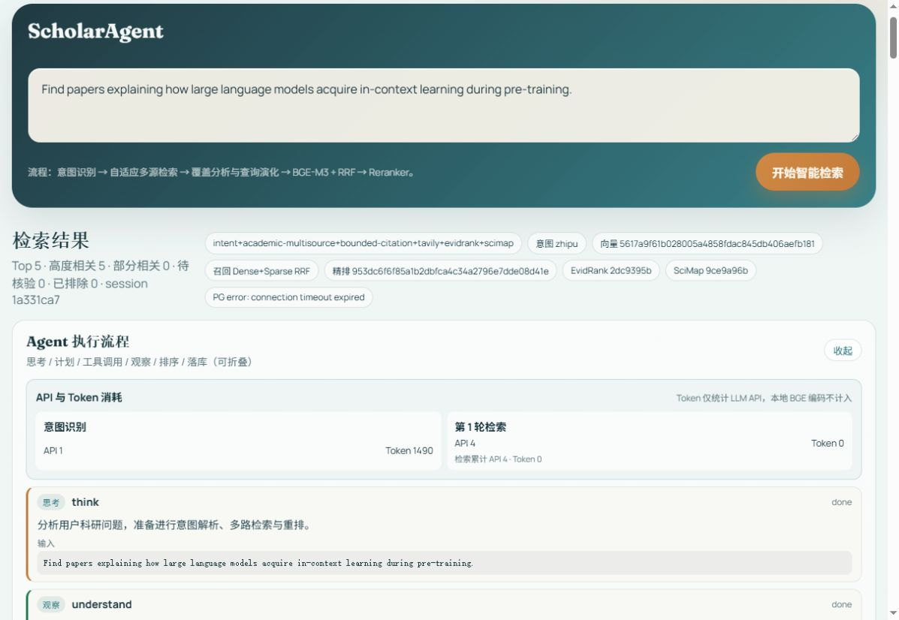
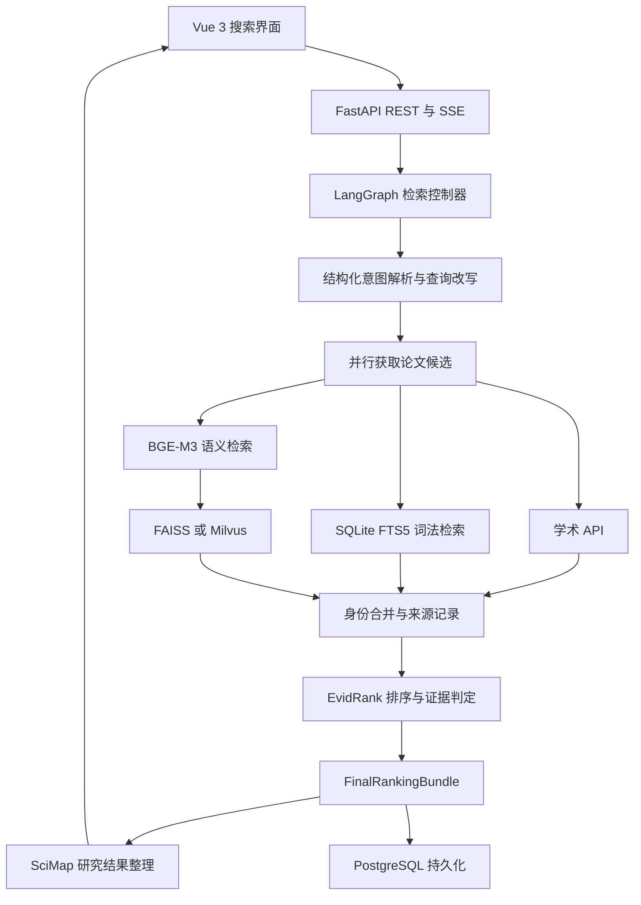
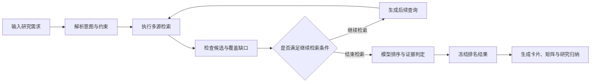

# ScholarAgent

面向科研问题的论文检索、证据排序与研究结果整理系统。

## 运行演示

以下图片来自 2026 年 10 月 11 日本地服务的真实运行。查询围绕大语言模型在预训练过程中获得 In-context Learning 能力的机制展开，页面展示论文检索、执行记录和研究证据整理。

### 研究需求与检索入口


### Agent 执行记录

界面记录检索步骤、模型调用与资源用量，支持展开查看执行过程。



### 论文结果与关系图

真实查询返回 5 篇论文，支持阅读摘要、查看论文来源和相关性判定，并通过关系图理解查询与研究主题之间的联系。


### SciMap 证据比较矩阵

本次网页查询生成 80 张论文证据卡片、2 条证据结论、3 条不确定性提示和 2 条事实关系边。矩阵将已有证据与缺失信息直接呈现，提供可回查的 Bundle 与 Artifact 标识。


演示使用真实学术检索服务、本地 BGE-M3、BGE-reranker-v2-m3 与 FAISS 索引，关闭 PaSa Selector。PostgreSQL 服务未启动，页面保留持久化异常提示。详细操作与配置见 [真实运行演示](docs/DEMO.md)。

## 查询与交互

用户可以输入包含研究主题、方法、数据集和时间范围的检索需求，例如“查找使用多查询改写改善科研论文检索的方法，并提供实验依据”。系统展示意图解析、工具调用、检索轮次和排序结果，支持查看论文卡片、比较矩阵、证据关系及评测记录。

| 功能 | 实现方式 |
| --- | --- |
| 理解研究需求 | 解析研究主题、实体、方法、数据集、时间范围与约束条件 |
| 生成检索查询 | 根据意图生成查询改写和子查询，保留原始查询中的关键术语 |
| 获取论文候选 | 并行访问学术来源，并执行本地词法检索和语义检索 |
| 调整检索过程 | 根据候选增量、覆盖缺口和调用预算决定后续检索 |
| 排序与核验 | 结合模型相关性、论文身份、元数据、约束与证据进行判定 |
| 整理研究结果 | 生成证据卡片、比较矩阵、时间线、可比性评估与归纳结论 |
| 查看执行记录 | 通过 SSE 展示执行进度，记录工具调用、API 次数和 Token 用量 |

## 系统架构



## 检索过程



检索控制器限制搜索轮次、API 调用次数和候选处理数量。每次检索保存来源、查询、返回数量与耗时，便于分析候选在哪个阶段被获取或被移除。

## 混合检索

### 学术来源

系统接入 arXiv、OpenAlex、Semantic Scholar、Serper Scholar，并根据研究领域选择 PubMed。Tavily 提供补充搜索能力。各来源通过统一的论文结构参与候选合并，保留原始来源与论文标识符。

HTTP 请求层支持连接复用、有界重试、请求节流、连续失败后的暂停调用和持久化缓存。检索控制器同时限制总调用预算，避免单个来源长期占用搜索时间。

### 本地词法检索

SQLite FTS5 对论文标题和摘要建立全文索引，使用 Porter 词干处理英文词形变化。检索保留原始查询中的关键术语，并结合结构化意图中的数据集、方法和实体生成查询。

### 本地语义检索

BGE-M3 同时生成 Dense 向量和 Sparse 权重。FAISS 后端使用归一化向量与 IndexFlatIP 执行稠密检索，稀疏倒排索引执行词项权重检索，两种排名通过 RRF 融合。系统也提供 Milvus 后端接口，可通过配置选择。

本地实验建立过 **568,059 篇论文的 BGE-M3 全库索引**。索引构建支持批处理、检查点和断点续传；稀疏索引限制每篇论文保存的词项数量，以控制内存占用。

查询变体复用意图解析阶段产生的改写和子查询，分别执行检索，再融合各个变体的排名。相关实现位于 `backend/app/services/local_vector_corpus.py`。

## EvidRank 排序与证据判定

### 排序流程

1. 将研究意图与论文候选转换为明确的数据结构。
2. 核验论文身份、版本、来源和元数据，记录字段来源与冲突。
3. 根据可信元数据核验硬约束，证据不足时保留待处理状态。
4. 使用 BGE-M3 计算 Dense 与 Sparse 信号，通过 RRF 生成候选排名。
5. 使用 BGE-reranker-v2-m3 对指定数量的候选执行 Cross-Encoder 精细排序，其余候选保留原有排名。
6. 按配置执行 PaSa 7B Selector 判别，并融合 Selector 排名。
7. 核验可定位的证据片段，生成相关性等级、原因和不确定性记录。
8. 由检索控制器冻结最终结果，生成 `FinalRankingBundle`。

Dense、Sparse、RRF、Cross-Encoder logit 和显示分数分别保存，供结果解释与实验分析使用。相关性等级结合排名、约束、身份和证据共同判定。

### PaSa 7B Selector

Selector 使用 `bytedance-research/pasa-7b-selector`，根据论文标题、摘要和原始用户查询执行 True/False 判别，读取首个生成 Token 对应的 P(True)。模型采用可配置的 4-bit 加载方式，并限制参与判别的候选数量。

已保存的融合实验使用权重 **0.30**、候选数量 **80** 和头部排名保护。服务支持模型分片目录、内存上限与批量推理，相关实现位于 `backend/app/services/pasa_selector.py`。

基础模型来自开源项目。本项目实现模型接入、推理资源控制、排名融合和实验验证。Selector 默认通过配置启用，使用前需要准备模型与相应运行资源。

## SciMap 研究结果整理

SciMap 接收经过冻结和哈希校验的 `FinalRankingBundle`，生成以下内容：

| 输出 | 作用 |
| --- | --- |
| 论文证据卡片 | 展示论文、研究分面和证据引用 |
| 比较矩阵 | 按研究需求组织方法、数据集与实验信息 |
| 可比性评估 | 检查实验上下文是否支持直接比较 |
| 时间线 | 展示论文年份与证据分布 |
| 证据关系图 | 表达 supports / violates 事实关系 |
| 研究归纳 | 整理支持结论、冲突、缺失证据与不可比情况 |

缺失证据在矩阵中保留为 `unknown`。输出保存 `artifact_hash`，并绑定输入的 `bundle_hash` 与 `intent_hash`，支持回查对应的意图、论文候选和排序结果。

## 实验结果

| 实验 | 基线结果 | 改进结果 | 数据集与方法 |
| --- | --- | --- | --- |
| EvidRank F1@5 | 11.90% | **13.91%** | NFCorpus test，323 条查询，共用 FTS 候选集合 |
| EvidRank MRR@5 | 51.89% | **56.35%** | 与上一项使用相同实验快照 |
| Selector 融合 hits@5 | 6 | **11** | RealScholarQuery，seed 42，5 条查询 |
| Selector 融合 MRR@5 | 0.667 | **0.740** | 与上一项使用相同端到端对照 |
| 向量召回 Recall@200 | 1.25% | **17.79%** | BEIR ArguAna，399 条查询，FTS 与全库向量检索对照 |
| Crawler 候选覆盖 | 78 / 556 | **93 / 556** | SPARBench，50 条逐查询记录，比较候选中的参考答案数量 |

结果来源：

- NFCorpus：`.modeling-audit/fixed_test_ablation.json`。
- Selector：`.modeling-audit/SELECTOR_INTEGRATION_REPORT.md` 与 `docs/evidence/runs/`。
- ArguAna：`.modeling-audit/beir_arguana_vector_recall.json`。
- SPARBench：`.modeling-audit/spar_crawler_vector_test.json` 与 `.modeling-audit/spar_pool_ranking_ab_test10.json`。

Selector 的结果来自 5 条查询的样本内对照，适用范围以该实验配置为限。Crawler 增加了候选覆盖，排序对照未显示稳定收益，默认配置关闭查询融合。SciMap 的自动结构实验发现引用完整性仍需改善，语义质量需要人工标注评估。

完整实验报告记录各项实验目的、实现方法、组件配置、指标、负向结果与复现命令，见 [消融实验报告](docs/ABLATION_REPORT.md)。

## 评测实现

| 评测类型 | 实现方法 | 衡量内容 |
| --- | --- | --- |
| 固定语料实验 | 使用数据集 corpus、qrels 与精确文档标识符 | 检索和排序组件的贡献 |
| Provider 快照实验 | `record` 保存响应，`frozen` 使用已保存响应 | 固定候选条件下的排序变化 |
| 开放网络实验 | 记录服务错误、失败查询、耗时、API 次数和 Token | 服务可靠性与运行成本 |

每次评测保存数据集 SHA-256、模型 revision、配置指纹、候选阶段记录与 Provider 快照信息。总体指标将失败查询计为零分，同时提供成功查询指标和失败分类。

组件消融通过关闭指定功能衡量贡献；逐级实验依次增加 Dense、Sparse RRF、Cross-Encoder 和 EvidRank。涉及检索配置变化的实验同时分析候选覆盖与最终排名。

## 使用的技术

| 系统部分 | 技术与组件 |
| --- | --- |
| 前端交互 | Vue 3、Vite、Axios、ECharts、SSE |
| 后端接口 | FastAPI、Pydantic、Uvicorn |
| Agent 编排 | LangGraph、结构化 LLM 意图解析 |
| 论文召回 | SQLite FTS5、FAISS、Milvus、BGE-M3、RRF |
| 论文排序 | BGE-reranker-v2-m3、PaSa 7B Selector、bitsandbytes、Accelerate |
| 证据组织 | EvidRank、SciMap、原文片段核验、哈希校验 |
| 数据保存 | PostgreSQL、SQLite 缓存 |
| 部署配置 | Docker Compose，包含 PostgreSQL、Redis、Milvus 等服务配置 |
| 自动验证 | pytest、前端生产构建、消融实验与候选阶段诊断 |

## 本地运行

建议使用 Python 3.11 与 Node.js 22.12 或更新版本。模型下载、语料准备、索引构建与 Selector 配置见 [运行指南](docs/SETUP.md)。

### 启动后端

```powershell
python -m venv .venv
.\.venv\Scripts\Activate.ps1
python -m pip install -r backend/requirements.txt
Copy-Item .env.example .env
```

在 `.env` 中配置所使用的学术 API、LLM 服务、模型路径和数据库连接。完成配置后运行：

```powershell
python -m uvicorn backend.app.main:app --host 127.0.0.1 --port 8000
```

### 启动前端

在另一个终端运行：

```powershell
cd frontend
npm ci
npm run dev
```

前端开发端口为 `5173`，后端端口为 `8000`。前端通过开发服务器将 `/api` 请求转发至后端。

### 使用容器运行

```bash
cp .env.example .env
docker compose up -d
docker compose --profile app up -d --build
```

容器运行需要配置 API、模型和数据库。Compose 中的后端默认使用 CPU；GPU 实验需要按照运行指南配置设备、权重与本地索引。

## 源码目录

| 路径 | 内容 |
| --- | --- |
| `backend/app/agent/` | LangGraph 状态与检索控制流程 |
| `backend/app/api/` | REST、SSE 和评测接口 |
| `backend/app/models/` | 意图、论文、排名、证据与评测数据结构 |
| `backend/app/services/ranking/` | EvidRank 排序与证据判定 |
| `backend/app/services/organizer/` | SciMap 研究结果整理 |
| `backend/scripts/` | 模型准备、索引构建、评测与消融脚本 |
| `backend/migrations/` | PostgreSQL 数据迁移 |
| `backend/paper-test/` | 评测入口与人工标注说明 |
| `backend/tests/` | 自动回归测试 |
| `frontend/src/` | 查询界面、执行轨迹、论文展示、关系图与评测面板 |
| `docs/` | 架构、运行、实验与发布说明 |
| `.modeling-audit/` | 实验指标与报告 |

模型权重、语料全集与检索索引按照运行指南单独准备。公开配置保存在 `.env.example`，本地服务凭据保存在 `.env`。

## 自动验证

```bash
python -m pytest backend/tests -q
cd frontend
npm ci
npm run build
```

发布准备过程中，后端 **148 项测试通过**，前端生产构建通过。真实学术 API、GPU 模型推理与完整容器部署需要对应的服务配置和运行资源。

## 项目文档

- [真实运行演示](docs/DEMO.md)
- [架构设计](docs/ARCHITECTURE.md)
- [运行与模型准备](docs/SETUP.md)
- [消融实验报告](docs/ABLATION_REPORT.md)
- [技术说明](docs/TECHNICAL_GUIDE.md)
- [评测协议](COMPETITION_EVALUATION_PROTOCOL.md)
- [发布说明](docs/RELEASE_NOTES.md)
- [第三方模型与数据](docs/THIRD_PARTY.md)
