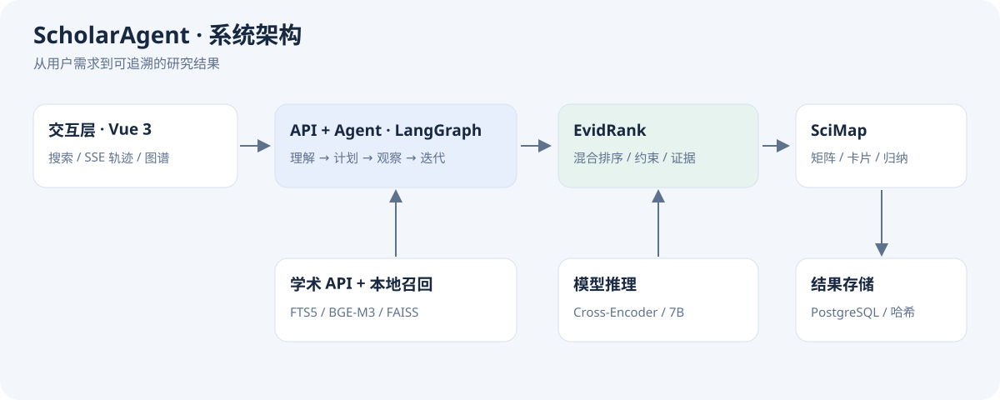

# 架构与关键取舍

## 模块边界

| 模块 | 输入 → 输出 | 源码 |
| --- | --- | --- |
| 查询理解 | 原始查询 → QueryUnderstanding | backend/app/services/llm_intent.py |
| Agent | 查询与状态 → 候选、执行轨迹 | backend/app/agent/ |
| 学术检索 | 变体 → 带来源论文 | backend/app/services/academic_search.py |
| 本地索引 | 查询 → 词法/向量排名 | local_pasa_corpus.py、local_vector_corpus.py |
| EvidRank | 研究意图与候选 → RankingBundle | backend/app/services/ranking/ |
| 控制器 | 排序结果 → FinalRankingBundle | bundle_builder.py |
| SciMap | 冻结结果 → OutputArtifact | backend/app/services/organizer/ |
| API / UI | REST 与 SSE → 可视化结果 | backend/app/api/、frontend/src/ |

## 设计取舍

FAISS 为默认本地混合后端，Milvus 提供可选服务后端。IndexFlatIP 对归一化向量执行精确内积检索，不宣称 ANN 百万级线上吞吐。Sparse 倒排限制文档 token 数以控制常驻内存。

RRF 通过排名而非原始分值融合不同通道。Cross-Encoder 仅精排 Top-N，未精排尾部保留原排名。Selector 可选，基于 5 条样本的最佳实验不替代默认低成本配置。

硬约束违反只有可信证据才能确定；未知元数据进入延后判断。排序结果在控制器结束搜索后冻结，SciMap 无权重新检索或改变排名。

SSE 使用 step / understanding / result / error 事件。网络层的重试、熔断、缓存与 Agent 总预算共同控制可靠性和成本。

## 实验状态

系统能力、配置实现、单元测试与真实部署分别描述。Redis 等 Compose 服务已提供配置，不因此声称所有业务路径均使用它们。完整生产负载、分布式扩展、用户规模和商业上线未验证。
